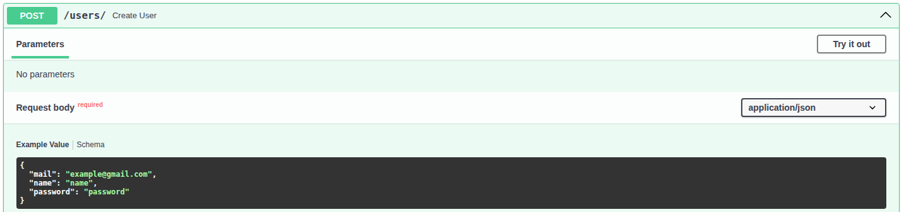
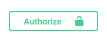
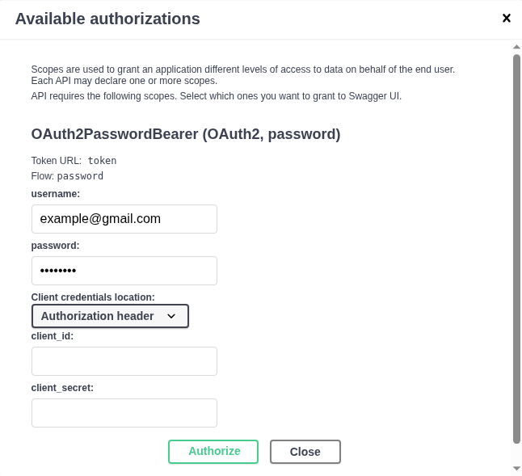
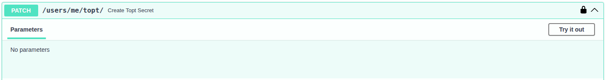
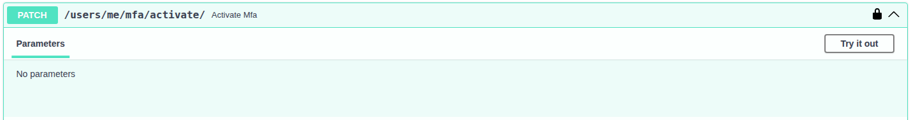
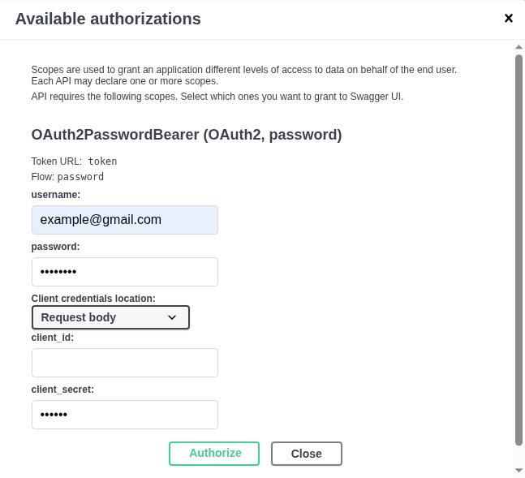

# Restful API with Multi-Factor Authentication (MFA)
## FastAPI CRUD Application with Integrated TOPT-Based Multifactor Authentication
The main idea of this project is to program a topt-based mfa using python. A fastapi app has been developed to simulate a crud application, allowing users to register and login. After the first login, users can create a topt token and its associated QR code using the different endpoints provided by the applicaiton. After a successful token creation, MFA can be enabled. Subsequent logins will require a verification code in addition to mail and password.

## How to install and run the developer app
1. Clone the project.
2. Move to the main folder `restful_api_mfa/` and create a python virtual environment.
3. Run `pip install -r requirements.txt` to install dependencies.
4. Run `python3 -m app.create_db` to create sqlite database.
5. Run `fastapi dev` to launch app. A dashboard is automatically created on `http://localhost:8000/docs`.

## How to enable mfa authentication
### Create user and login
Use "Create User" endpoint to create an user.

Press authorize button, on right top corner of the page, to pop up the autherization form.

Then, authenticate the created user using mail plus password.

### Create topt token and enable mfa
Use "Create TOPT Secret" endpoint to create a topt token for the login user. This endpoint also send the QR code in the response. This QR must by scanned with an authenticator app.

User "Activate MFA" endpoint to enable mfa.

### Login with mfa
In following logins, it is going to be mandatory to add a six digits code (XXXXXX) provided by an authenticator app. It is important to switch "Client credentials location" to "Request Body".

